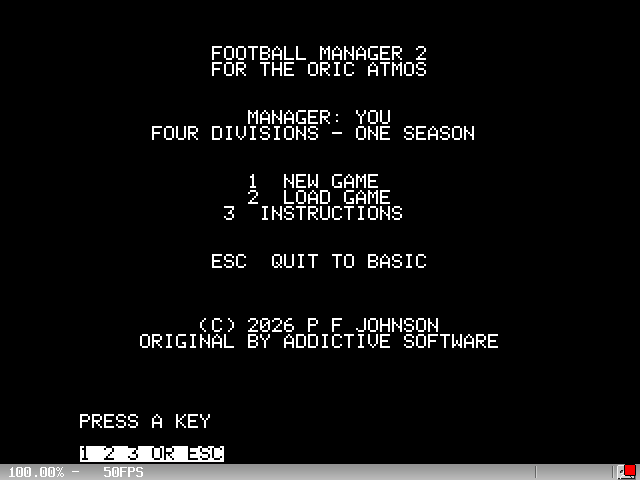
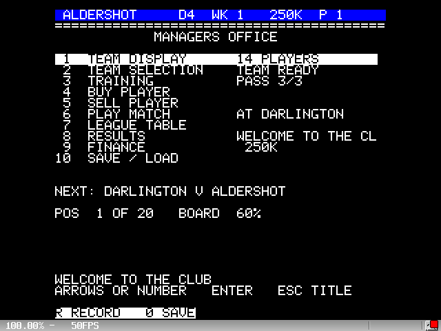
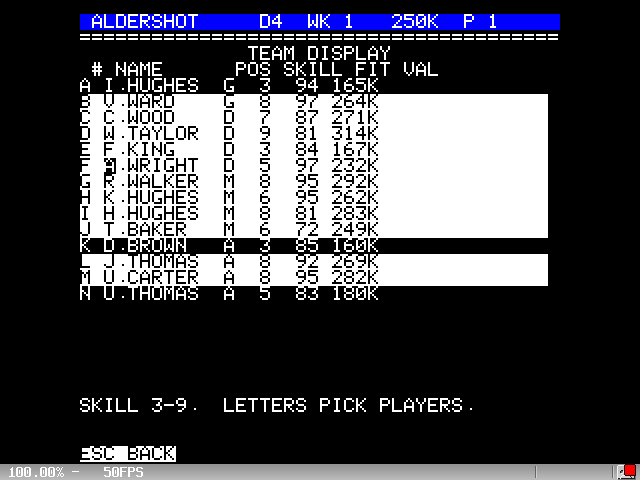
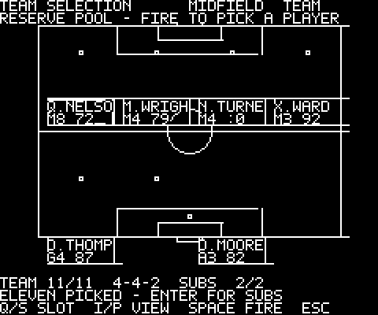
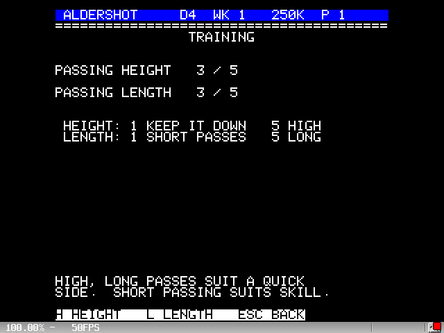
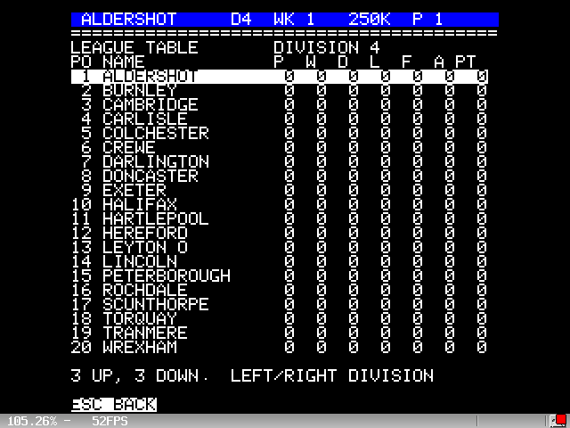
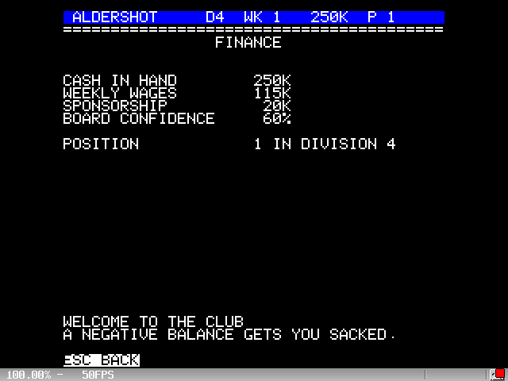
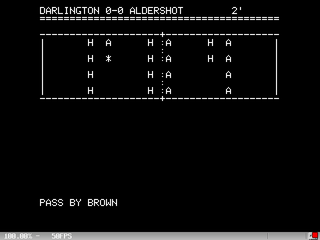

# Football Manager 2 — Oric Atmos port

A from-scratch port of **Football Manager 2** (Addictive Software, 1988,
by Kevin Toms) to the Tangerine Oric Atmos.  The game is written in C
with 6502 assembly for everything that touches the hardware, and runs on
a real 1 MHz Oric or in Oricutron.

It follows the Spectrum sequel rather than the 1982 original:

* **Four divisions of twenty clubs** (80 clubs), one meeting with every
  other club, three up and three down at the end of the season.  You
  start in Division 4.
* **FM2 player attributes** — name, position (G/D/M/A), skill 3–9 and
  value in thousands, plus fitness out of 100.  A player used out of
  position counts as skill 2.
* **Twelve outfield zones** laid out over defence, midfield and attack,
  picked on a HIRES pitch page the way the Spectrum game does it: the
  pitch is drawn with the defence, midfield and attack bands, a reserve
  pool above it and two substitute slots below.  You take a player from
  the pool and drop him into a position; fire on a filled position lifts
  him so two players can be swapped.  So a 4-4-2, 4-3-3 or 4-2-4 falls
  out of where you put them; leaving a zone empty gives the opposition
  space, filling it marks their man.
* **Passing-height and passing-length training**, as in the original.
* **The action**: the match is played out as a series of animated
  sequences over a 240x200 HIRES pitch, with the ball moving between
  engine frames, a running scoreboard, one-line commentary and a
  half-time team talk where you can change the side.  Every pixel goes
  through an assembly blitter (`src/hires.s`), so a redraw costs stores
  rather than a C loop per pixel.
* **Two cups** — the FA Cup and the League Cup — drawn as 32-club
  knockouts during the season.
* Sponsorship, gate receipts, wages, board confidence, the manager's
  record, and cassette save/load.

## Screens



| | |
|---|---|
|  |  |
|  |  |
|  |  |



Regenerate them at any time with `python tests/make_screenshots.py`.

## Controls

| Key | Action |
|-----|--------|
| `Q` / `A` (or 8 / 2) | up / down |
| `I` / `P` | left / right, and the defence/midfield/attack views |
| `ENTER` | confirm |
| `SPACE` | clear a zone, advance the action |
| `A`–`P` | pick a squad player in team selection |
| `H` / `L` | passing height / length in training |
| `ESC` | back |

## Building

The build uses [cc65](https://cc65.github.io/); see [BUILD.md](BUILD.md).

```
python tools/build.py all       # game, self-test tape and the unit tests
python tools/build.py game      # build/fm2.tap
python tools/build.py unit      # sim65 unit tests
```

`build/fm2.tap` autostarts: `CLOAD""` in BASIC and the game is running.

## Testing

* **Unit tests** (`tests/test_core.c`) run on the host under `sim65` and
  cover the fixture generator, the tables, the zone selection, the
  action engine, the cups, transfers, finances and save/restore.
* **On-machine self test** (`build/selftest.tap`) runs the same tests on
  the real 6502 and prints the results on screen.
* **End-to-end tests** (`tests/e2e_oricutron.py`) drive the real game in
  Oricutron, typing on its keyboard and reading the 40x28 text screen
  back through the emulator's clipboard copy.

```
python tools/build.py all
python tests/e2e_oricutron.py            # the game
python tests/e2e_oricutron.py --selftest # the on-machine tests
```

## Source layout

| File | What it does |
|------|--------------|
| `src/game.c` | divisions, round-robin fixtures, tables, squads, zones, cups, finances, save block |
| `src/match.c` | the action engine: possession, passes, tackles, shots, goals, half time |
| `src/main.c` | every screen and the game flow |
| `src/ui.c` | line builder and the page furniture for the text screens |
| `src/hires.c` | rectangles, circles and markers drawn on the bitmap |
| `src/select.c` | the HIRES team-selection page |
| `src/action.c` | the HIRES match-action pitch and scoreboard |
| `src/scr.s` | 40x28 text driver (cursor, strings, attributes, inverse video) |
| `src/hires.s` | bitmap driver: plot, line fills, 5x7 text, mode switch |
| `src/font.s` | packed 5x7 font for the bitmap pages (generated) |
| `src/kbd.s` | 50 Hz interrupt-driven keyboard scanner and key queue |
| `src/snd.s` | AY-3-8912 clicks, goal jingle and whistle |
| `src/tape.s` | cassette save/load through the Atmos ROM routines |
| `src/sys.s` | soft reset back to BASIC |
| `oric.cfg` | ld65 config: autostart tape header, 448-byte stack, save block at `$A000` |

## Notes on the port

* The text screen at `$BB80` is written directly; serial attributes give
  the coloured bars.
* The keyboard is scanned from the 50 Hz VIA interrupt, so a key pressed
  while a screen is being drawn is still waiting when the menu returns
  for input.
* Fixtures are generated arithmetically (circle method) rather than
  stored, which keeps the game inside 37K of RAM.
* Football Manager 2 is a trademark of Addictive Software; this is an
  unofficial tribute port, written from scratch.

## Licence

The **DILLIGAF licence** (*Do I Look Like I Give A F\*\*\**): do what you
like with it - copy, change, sell, port it - with no attribution and no
warranty.  The full text is in [LICENSE](LICENSE).  It is not an
OSI-approved licence, which will surprise nobody.
